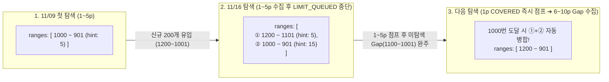

# ADR-003: 다중 구간(Multi-Range) 체크포인트 도입 및 구간 자동 병합 설계

* **문서 상태**: 승인됨 (Accepted)
* **결정 일자**: 2026-11-11
* **결정 주체**: 프로젝트 설계자 (Yeon)
* **문맥 키워드**: `Architecture Decision Record`, `Multi-Range Checkpoint`, `Interval Merging`, `Gap Recovery`, `scanController`, `checkpointManager`

---

## 1. 개편 배경 및 문제 정의 (Context & Problem Statement)

기존 체크포인트 시스템([`tools/checkpointManager.js`](../../tools/checkpointManager.js), [`tools/scanController.js`](../../tools/scanController.js))은 플랫폼·트랙별로 **단 1개의 연속된 탐색 완료 구간(`[tailJobId, headJobId]`)** 만을 저장하는 단일 구간(Single-Range) 모델이었습니다.

이 모델은 **"매일(Daily) 실행되어 새로 올라온 공고 수가 1회 탐색 한도(`maxQueuedPerTrack: 100`)보다 적다"** 는 전제에서는 정상 동작했으나, **며칠~일주일 이상 간격으로 실행하여 신규 공고가 대량 유입된 상황(신규 유입량 > 1회 수집 상한)** 에서 구조적인 한계가 드러났습니다.

### 🚨 핵심 문제: 단일 구간 모델의 딜레마 (Single-Range Dilemma)

예를 들어 11월 9일에 1~5페이지(ID `1000` ~ `901`)를 탐색하여 `Head: 1000, Tail: 901`이 기록된 상태에서, 일주일 뒤(11월 16일) 신규 공고 200개(ID `1200` ~ `1001`, 1~10페이지 분량)가 새로 올라와 기존 구간이 11~15페이지로 밀려난 상황을 가정해 봅니다.

1. **Head를 섣불리 갱신할 수 없음 (중간 구멍 발생 방지)**:
   - 11월 16일 실행 시 1~5페이지(ID `1200` ~ `1101`)에서 100개를 채워 `LIMIT_QUEUED`로 멈추게 됩니다 (`phase1Complete = false`).
   - 이때 만약 `Head`를 `1200`으로 올려버리면, 체크포인트 구간이 `[901, 1200]`이 되어 **아직 보지 못한 6~10페이지(ID `1100` ~ `1001`)가 `COVERED`로 둔갑해 영구 누락**됩니다.
   - 따라서 기존 로직은 `phase1Complete === false`일 때 **체크포인트를 아예 갱신하지 않고 기존 값(`1000 ~ 901`)을 유지**하도록 방어했습니다.
2. **체크포인트의 화석화 (Fossilization)**:
   - 만약 그다음 주(11월 23일)에 또 10페이지(ID `1400` ~ `1201`)가 새로 올라오면, 탐색은 다시 1~5페이지(`1400` ~ `1301`)에서 `LIMIT_QUEUED`로 멈춥니다.
   - 결과적으로 기존 체크포인트(`1000 ~ 901`)는 21페이지 밖으로 밀려나고, **체크포인트 파일은 몇 주가 지나도 영원히 갱신되지 않는 화석화 현상**이 발생합니다.
3. **페이지 점프(`JUMP_PAGE`) 무력화 및 `LIMIT_PAGES` 도달**:
   - 지난 세션에서 탐색한 구간(`1200 ~ 1101`)은 `registry.json`에만 기록되어 있을 뿐 체크포인트에는 반영되지 않았으므로, 다음 실행 시 1~5페이지를 `JUMP_PAGE`로 건너뛰지 못하고 매번 1페이지부터 한 장씩(`NEXT_PAGE`) 다시 읽어야 합니다.
   - 이 상태가 누적되면 정작 미탐색 구멍에 도달하기도 전에 `maxPagesPerTrack(20페이지)` 상한에 걸려 탐색이 조기 종료됩니다.

---

## 2. 대안 검토 ( Considered Options )

이 구조적 한계를 해결하기 위해 두 가지 아키텍처 대안을 비교 검토했습니다.

| 비교 항목 | 방안 1: 다중 구간(Multi-Range) + 구간 자동 병합 (채택 ⭐) | 방안 2: 상단 슬라이딩 리셋 (Stale Checkpoint Reset) |
| :--- | :--- | :--- |
| **핵심 개념** | 체크포인트를 단일 구간이 아닌 **`ranges` 배열**로 관리하고, 탐색한 모든 구간을 보존 및 접촉 시 자동 병합(Merge Intervals) | `LIMIT_QUEUED`/`LIMIT_PAGES` 도달 시 기존 Head를 못 만났다면 기존 체크포인트를 버리고 **이번 세션 구간으로 덮어쓰기** |
| **미탐색 구멍(Gap) 누락 여부** | **누락 0건** (구간 사이의 Gap을 `NEW`로 정확히 식별하여 다음 실행 시 수집) | 중간에 밀린 페이지(예: 6~10페이지)는 포기(Skip)됨 |
| **페이지 점프(`JUMP_PAGE`)** | 상단 첫 번째 구간(`ranges[0]`) 진입 즉시 `tailPageHint`로 점프하여 미탐색 Gap부터 바로 탐색 | 리셋 이후부터만 점프 가능 |
| **구현 복잡도** | 중간 (`mergeRanges`, `classifyIdWithRange`, 구간별 점프 제어 구현 필요) | 낮음 (조건문 일부 수정) |

### 💡 의사결정 결론
채용공고 수집 시스템의 핵심 가치는 **"공고 누락 없이 이미 확인한 구간만 정확히 건너뛰는 것"** 이므로, 미탐색 공백(Gap)을 유실하지 않으면서도 상단 기수집 구간을 즉시 점프할 수 있는 **[방안 1: 다중 구간(Multi-Range) 체크포인트 + 구간 자동 병합]** 모델을 채택했습니다. 또한 기존 체크포인트 데이터를 모두 초기화하고 새로 시작함에 따라 불필요한 레거시 단일 필드(`cp.headJobId`, `cp.tailJobId`)를 완전히 제거하고 **`ranges` 배열 단일 스키마**로 일원화했습니다.

---

## 3. 상세 설계 및 동작 원리 (Detailed Design)

### 3.1. `ranges` 단일 체크포인트 스키마
각 트랙의 체크포인트 파일(`data/checkpoints/{site}/{track}.json`)과 임시 제안 파일(`proposed_checkpoint.json`)은 내림차순(최신 구간 우선)으로 정렬된 `ranges` 배열만을 관리합니다.

```json
{
  "site": "saramin",
  "track": "track1",
  "ranges": [
    {
      "headJobId": "55496603",
      "headWindow": ["55496603", "55495844", "55495506"],
      "tailJobId": "55200100",
      "tailWindow": ["55200500", "55200300", "55200100"],
      "tailPageHint": 5
    },
    {
      "headJobId": "55053325",
      "headWindow": ["55053325", "55053324", "55036577"],
      "tailJobId": "55002287",
      "tailWindow": ["55002287", "55000563", "54998016"],
      "tailPageHint": 15
    }
  ],
  "updatedAt": "2026-11-11T19:00:00+09:00"
}
```

### 3.2. 다중 구간 기반 ID 분류 (`classifyIdWithRange`)
[`checkpointManager.js`](../../tools/checkpointManager.js)의 `classifyIdWithRange(id, cp)`는 공고 ID를 `ranges` 배열과 비교하여 `{ status, rangeIndex }`를 반환합니다:

1. **윈도우 앵커 매칭 (1순위)**: 어느 구간(`ranges[idx]`)이든 `headWindow`, `tailWindow`, `headJobId`, `tailJobId`에 해당 ID가 존재하면 즉시 `{ status: 'COVERED', rangeIndex: idx }`를 반환합니다. (ID 역전이 발생하는 잡코리아·원티드 대응)
2. **숫자(`BigInt`) 범위 비교 (2순위)**: 내림차순 정렬된 `ranges`를 순회하며:
   * `id > ranges[0].headJobId`: 최상단 구간보다 최신인 공고 ➔ **`NEW`** (`rangeIndex: -1`)
   * `ranges[idx].tailJobId <= id <= ranges[idx].headJobId`: `idx`번째 구간 내부 ➔ **`COVERED`** (`rangeIndex: idx`)
   * `ranges[idx+1].headJobId < id < ranges[idx].tailJobId`: **두 `COVERED` 구간 사이에 낀 미탐색 공백(Gap)** ➔ **`NEW`** (`rangeIndex: -1`)로 판정하여 심사 큐에 정상 적재!
   * `id < ranges[last].tailJobId`: 최하단 구간보다도 오래된 과거 미탐색 공고 ➔ **`OLD`** (`rangeIndex: -1`)

### 3.3. 구간 보존, 점프 및 자동 병합 시나리오



1. **중도 중단 시에도 신규 구간 보존**:
   - `scanController.js`는 탐색 도중 `currentGapHead`와 `currentGapLastIds`를 추적합니다.
   - 기존 체크포인트에 닿기 전에 `LIMIT_QUEUED`나 `LIMIT_PAGES`로 멈추더라도, 이번 세션에 탐색한 구간을 버리지 않고 `candidateRanges`에 추가합니다.
2. **구간별 스마트 점프 (`jumpedRanges`)**:
   - 다음 실행 시 1페이지에서 첫 번째 구간(`ranges[0]: 1200 ~ 1101`)을 만나면 `COVERED`(`rangeIndex: 0`)로 인식합니다.
   - `jumpEnabled: true`(사람인)인 경우 1~5페이지를 일일이 넘기지 않고 `ranges[0].tailPageHint`(5페이지) 기반으로 **즉시 미탐색 Gap 시작점(5~6페이지)으로 `JUMP_PAGE`** 합니다.
   - 만약 점프한 페이지의 첫 항목이 현재 구간의 `tailJobId`를 지나쳤다면(`isOvershotRange`), `COVERED`가 포함된 페이지를 찾을 때까지 1페이지씩 되돌아오는(Backtracking) 안전장치가 동일하게 작동합니다.
3. **구간 자동 병합 (`mergeRanges`)**:
   - 미탐색 공백(`1100 ~ 1001`)을 모두 수집하고 두 번째 구간의 상단(`1000`)과 만나는 순간, [`mergeRanges()`](../../tools/checkpointManager.js)가 겹치거나 맞닿은(`prev.tailJobId <= curr.headJobId` 또는 윈도우 교집합 존재) 두 구간을 **`[1200 ~ 901]` 단일 구간으로 자동 병합**합니다.

---

## 4. 검증 결과 (Verification)

[`tests/scanController.test.js`](../../tests/scanController.test.js)를 `ranges` 단일 스키마 기준으로 전면 개편하고, 다중 구간 시나리오 테스트를 추가하여 전체 **52개 단위 테스트 전원 통과**를 확인했습니다.

* **테스트 #6 (`Phase 1 도중 LIMIT_QUEUED`)**: 기존 체크포인트(`[100 ~ 50]`) 도달 전 상단(`[130 ~ 125]`)에서 중단 시 `ranges` 배열에 2개 구간이 모두 보존되며, 사이 공백(`115`)은 `NEW`, 각 구간 내부(`125`, `95`)는 `COVERED`, 최하단 밖(`30`)은 `OLD`로 정확히 분류됨을 검증.
* **테스트 #11 (`다중 구간 점프 및 구간 자동 병합 시뮬레이션`)**: 2개의 분리된 구간(`[1200 ~ 1101]`, `[1000 ~ 901]`)이 있을 때 1페이지에서 즉시 5페이지로 점프하여 중간 공백(`1100`, `1050`, `1001`)만 수집한 뒤, `1000`번 도달 후 종료 시 단일 구간(`[1200 ~ 901]`)으로 병합됨을 검증.

